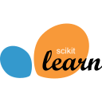

## 👨‍💻 About me

👋 Hi, I'm **Dmitriy Pashkov**!

🎓 I'm a third-year **Computer Technologies** student at **ITMO University**, Faculty of Information Technologies and Programming.

🏫 I graduated from **Presidential Physics and Mathematics Lyceum No. 239** and studied at its Mathematics Center.

🏅 Mathematics olympiad winner and prize-winner — [**five diplomas**](https://github.com/d-pashkov/achievements/tree/main/diplomas).

👀 I'm interested in **machine learning**, mathematical optimization and algorithms, and I'm looking for an **ML internship**.

📫 **Telegram:** [@dmitriy_pashkov](https://t.me/dmitriy_pashkov) · **Email:** [dmitriy@pashkov.net](mailto:dmitriy@pashkov.net)

## 🧰 Languages and tools

### Machine Learning & Data

  &nbsp;
  &nbsp;
  &nbsp;
  &nbsp;
  &nbsp;
  &nbsp;

### Programming

  &nbsp;
  &nbsp;
  &nbsp;
  &nbsp;

### Tools

  &nbsp;
  &nbsp;
  &nbsp;
  &nbsp;

## 🚀 Selected projects

| Project | What it covers |
| --- | --- |
| [Linear classification from scratch](https://github.com/d-pashkov/linear-classification-from-scratch) | NumPy implementation, regularization, cross-validation and model evaluation |
| [Optimization methods](https://github.com/d-pashkov/optimization-methods) | Gradient descent, Newton/BFGS, SGD/Nadam, autodiff and experiments |
| [Go e-commerce microservices](https://github.com/d-pashkov/go-ecommerce-microservices) | gRPC, PostgreSQL, transactional outbox and Docker Compose |

More coursework: [Java Advanced](https://github.com/d-pashkov/java-advanced) · [C++ data structures](https://github.com/d-pashkov/cpp-data-structures) · [Linux OS labs](https://github.com/d-pashkov/linux-os-labs).
